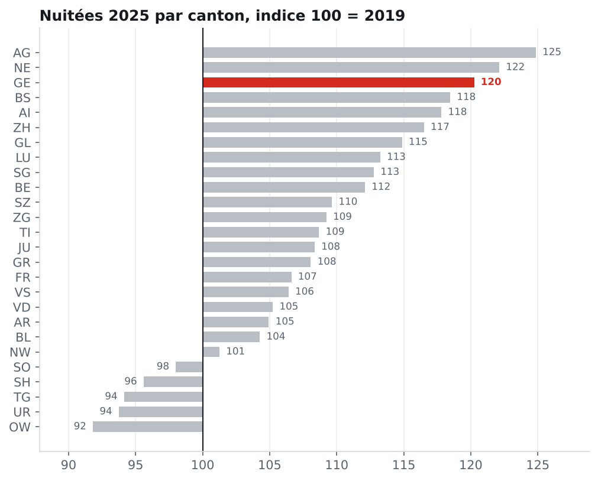

# Le tourisme hôtelier en Suisse : un projet BI de bout en bout

**Question** : comment se porte l'hôtellerie genevoise depuis le COVID, face aux autres cantons, et où sont les leviers de croissance ?

Un projet complet de **Business Intelligence et de Business Analysis** sur des données officielles de l'Office fédéral de la statistique : du besoin métier jusqu'aux recommandations, en passant par un modèle en étoile testé et un rapport **Power BI** avec ses mesures **DAX**.

> *EN : An end-to-end BI and business analysis project on official Swiss hotel statistics: requirements, KPI dictionary, tested star schema refreshed monthly by GitHub Actions, Power BI report with DAX measures, UAT and an executive memo with recommendations.*

[](https://github.com/Toumil94/analyse-bi-suisse/actions/workflows/refresh.yml)

## Les résultats en un coup d'œil

- Genève termine 2025 à **120 % de son niveau de 2019**, 3e meilleure reprise sur 26 cantons, après la chute la plus forte du pays pendant le COVID.
- La croissance repose sur la **clientèle suisse** (168 % de 2019) et sur les États-Unis, la France et le Royaume-Uni.
- Les **pays du Golfe** sont le seul grand marché pas revenu (92 %), avec un recul concentré sur juillet-août.
- Taux d'occupation des chambres de **68 %** à Genève contre 57 % en Suisse, mais seulement **51 % en janvier**.

La note complète : [**recommandations**](docs/05_recommandations.md).




## La démarche, comme en entreprise

| Étape | Livrable |
|---|---|
| 1. Comprendre le besoin | [Cahier des charges](docs/01_cahier_des_charges.md) : contexte, parties prenantes, questions métier, exigences, user stories |
| 2. Définir les indicateurs | [Dictionnaire des KPI](docs/02_dictionnaire_kpi.md) : définition, formule, source, pièges de chaque indicateur |
| 3. Modéliser | [Modèle de données](docs/03_modele_de_donnees.md) : constellation de deux faits et trois dimensions, grain, choix justifiés |
| 4. Industrialiser | [Pipeline](pipeline/build.py) : extraction mensuelle depuis l'API de l'OFS, contrôles qualité bloquants, publication automatique |
| 5. Restituer | [Rapport Power BI](powerbi/) : requêtes Power Query, [mesures DAX](powerbi/mesures.dax), thème, guide de construction |
| 6. Valider | [Cahier de recette](docs/04_recette.md) : contrôles automatiques et 17 tests chiffrés du rapport |
| 7. Recommander | [Note à la direction](docs/05_recommandations.md) : constats, recommandations, limites |

## Points techniques

- **Données** : API PX-Web de l'OFS (statistique HESTA), environ 400 000 lignes mensuelles depuis 2005, par canton et par pays de provenance.
- **Qualité** : la somme des pays et des cantons retrouve **exactement** les totaux publiés par l'OFS (écart 0,000 %), vérifié à chaque mise à jour.
- **Taux d'occupation exact** : l'OFS calcule le taux sur les jours d'ouverture effectifs, une donnée non publiée. Le pipeline reconstitue la capacité à partir du taux publié, pour que le taux agrégé dans Power BI retrouve celui de l'OFS à tous les niveaux. Sans cela, l'écart serait de 1,1 point en moyenne.
- **Nomenclature changeante** : certains pays étaient regroupés autrefois (« Pays du Golfe »), puis détaillés. Une colonne de marché harmonisé permet de comparer 2019 et aujourd'hui.
- **DAX** : intelligence temporelle (A-1, cumul annuel, 12 mois glissants), comparaison aux mêmes mois de 2019 avec `TREATAS`, parts de marché, contribution à la croissance, classements.
- **Automatisation** : GitHub Actions met à jour les données chaque mois. Power BI les lit directement sur GitHub : une actualisation suffit.

## Structure

```
docs/        cahier des charges, KPI, modèle, recette, recommandations, graphiques
pipeline/    build.py (extraction et modélisation), analyse.py (chiffres de référence et graphiques)
data/        tables CSV du modèle en étoile + controles.json
powerbi/     GUIDE.md, requêtes Power Query (.m), mesures.dax, thème
tests/       contrôles qualité (pytest)
```

## Reproduire

```bash
pip install -r requirements.txt
python pipeline/build.py      # environ 10 minutes, une requête par seconde vers l'API de l'OFS
python -m pytest tests
python pipeline/analyse.py
```

Puis construire le rapport en suivant [`powerbi/GUIDE.md`](powerbi/GUIDE.md).

## Auteur

**Lyes Toumi**, Data & AI Engineer et Business Analyst BI à Genève. Trois ans de BI chez EssilorLuxottica (migration Qlik vers SAP BusinessObjects, 30 à 40 tableaux de bord). [Portfolio](https://toumilyes.netlify.app) · [LinkedIn](https://www.linkedin.com/in/lyes-toumi/)

*Source des données : Office fédéral de la statistique (OFS), statistique de l'hébergement touristique (HESTA). Projet indépendant.*
