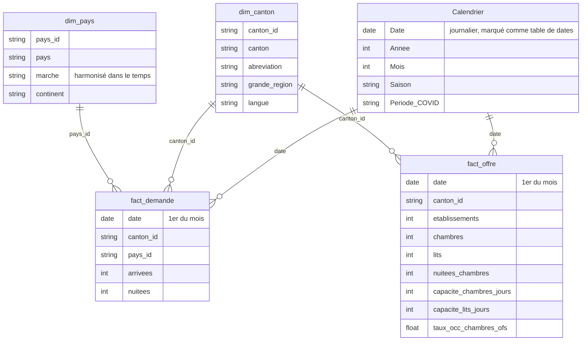
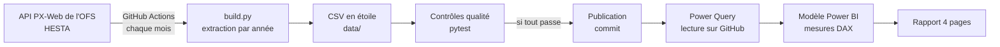

# Modèle de données

Un schéma en étoile avec deux tables de faits qui partagent les mêmes dimensions (on parle de « constellation »).

## Grain

| Table | Une ligne représente | Volume |
|---|---|---|
| `fact_demande` | un mois × un canton × un pays de provenance | environ 400 000 lignes |
| `fact_offre` | un mois × un canton | environ 6 800 lignes |

**Pourquoi deux tables de faits et pas une ?** L'offre (chambres, lits) n'existe pas par pays de provenance : la mettre dans la même table que la demande obligerait à la répéter pour chaque pays et fausserait les sommes. Deux faits au grain naturel, reliés par les dimensions communes, évitent ce piège.

## Choix de modélisation

- **Calendrier journalier.** Les faits sont mensuels (datés au 1er du mois), mais les fonctions d'intelligence temporelle de DAX (`SAMEPERIODLASTYEAR`, `TOTALYTD`) exigent une table de dates continue. Le calendrier est donc une table DAX journalière, marquée comme table de dates.
- **Relations à sens unique**, de la dimension vers le fait. `dim_pays` ne filtre que `fact_demande`.
- **Pas de total Suisse stocké.** Les totaux sont toujours calculés par somme, ce qui évite les doubles comptes. Les totaux publiés par l'OFS servent uniquement aux contrôles.
- **Source unique.** Power Query lit les CSV directement sur GitHub (paramètre `BaseUrl`). Une actualisation dans Power BI suffit pour obtenir le dernier mois publié.

## Chaîne de traitement

