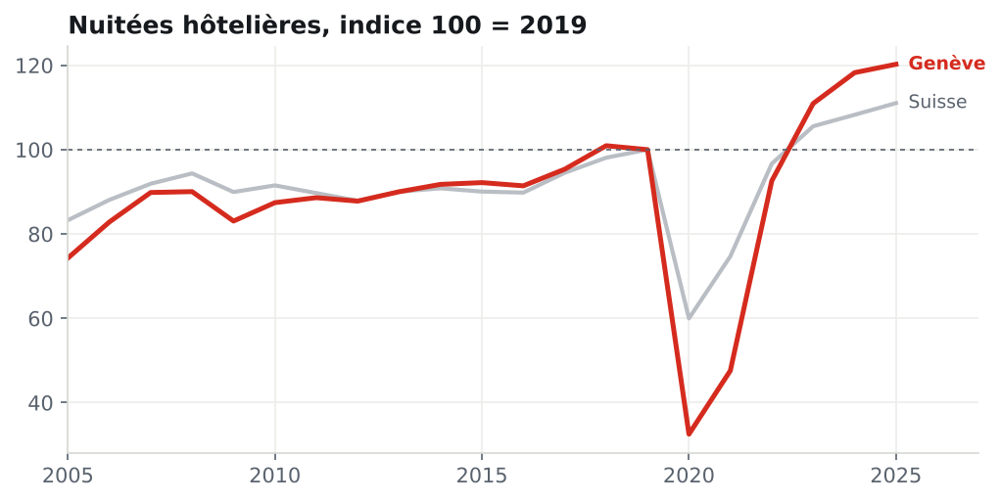
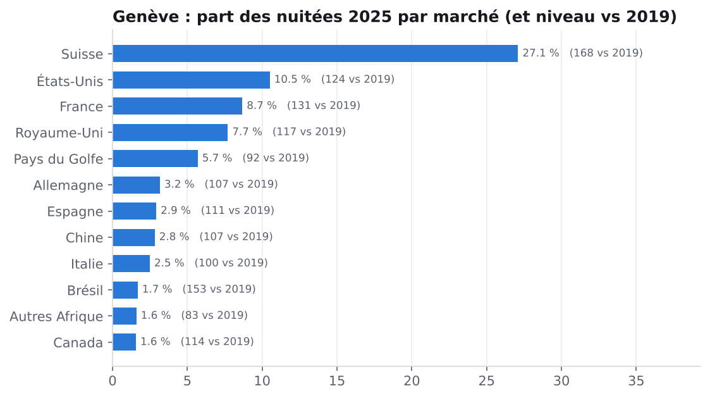
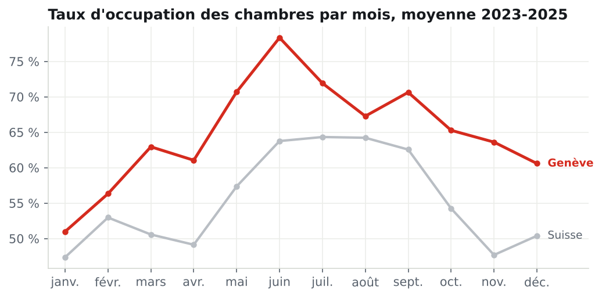

# Note de recommandations : l'hôtellerie genevoise en 2025

**À** : Direction de l'office du tourisme (cas d'étude)
**Données** : OFS, statistique HESTA, de janvier 2005 à août 2026
**Rapport associé** : tableau de bord Power BI, 4 pages

---

## En bref

Genève a réussi la reprise la plus spectaculaire de Suisse : partie du plus bas (32 % du niveau de 2019 en 2020), elle termine 2025 à **120 % de son niveau d'avant crise**, 3e canton sur 26. Cette croissance repose surtout sur la **clientèle suisse** (+68 % depuis 2019) et sur les **États-Unis, la France et le Royaume-Uni**. Deux points de vigilance : la croissance **marque le pas en 2026**, et les **pays du Golfe**, cinquième marché, ne sont **toujours pas revenus** à leur niveau de 2019, surtout en été.

## 1. Une reprise record, mais un plateau en 2026

| Indicateur | Genève | Suisse |
|---|---|---|
| Nuitées 2025 | 3,85 millions | 43,9 millions |
| Niveau 2025 vs 2019 | **120 %** (3e canton) | 111 % |
| Niveau 2020 vs 2019 (creux COVID) | 32 % | 60 % |
| Taux d'occupation des chambres 2025 | **68,0 %** | 56,8 % |
| Durée moyenne de séjour 2025 | 1,93 nuit | 1,98 nuit |
| Part des clients étrangers 2025 | 72,9 % | 51,9 % |
| Janvier à août 2026 vs même période 2025 | **-0,3 %** | -0,7 % |

Genève, plus dépendante des voyages internationaux et d'affaires, a chuté bien plus fort que la Suisse pendant le COVID (-68 % en 2020, contre -40 %), puis l'a dépassée dès 2023. En 2026, la croissance s'arrête : c'est le signal qu'un nouvel équilibre est atteint et que la suite dépendra de décisions de promotion, plus du simple rattrapage.

## 2. La clientèle suisse porte la croissance

Les clients domiciliés en Suisse représentent **27 % des nuitées** genevoises en 2025, contre environ 19 % en 2019 : **1,04 million de nuitées, soit 168 % du niveau de 2019**. Cette clientèle de proximité, découverte pendant la crise, est restée.

| Marché (2025) | Part des nuitées | Niveau vs 2019 |
|---|---|---|
| Suisse | 27,1 % | 168 % |
| États-Unis | 10,5 % | 124 % |
| France | 8,7 % | 131 % |
| Royaume-Uni | 7,7 % | 117 % |
| Pays du Golfe | 5,7 % | **92 %** |
| Allemagne | 3,2 % | 107 % |
| Chine | 2,8 % | 107 % |
| Italie | 2,5 % | 100 % |

## 3. Les pays du Golfe : le seul grand marché pas revenu, et c'est un problème d'été

Les pays du Golfe sont le cinquième marché de Genève, mais restent à **92 % de leur niveau de 2019** (219 000 nuitées contre 239 000). Le recul se concentre sur l'été : **35 % de leurs nuitées tombent en juillet et août**, et ces deux mois ont perdu **26 500 nuitées** par rapport à 2019, soit plus que le recul total de l'année. Sur le reste de l'année, le marché est globalement revenu : l'hiver (décembre à février) et mai dépassent 2019, même si mars, avril et juin restent en retrait.

## 4. L'occupation est forte, mais l'hiver reste à remplir

Sur 2023-2025, le taux d'occupation des chambres va de **51 % en janvier** à **78 % en juin**, toujours au-dessus de la moyenne suisse. L'écart d'environ 27 points entre le mois le plus creux et le plus plein représente la principale réserve de croissance : des chambres existent déjà, il faut des clients en janvier, février, avril et décembre.

À noter : le nombre moyen de chambres offertes a baissé d'environ 6 % entre 2024 et 2025, ce qui explique une partie de la hausse du taux d'occupation. Le taux seul ne suffit donc pas à juger la performance : il faut le lire avec les nuitées.

## Recommandations

1. **Cibler la basse saison** (janvier, février, décembre) : congrès et événements d'affaires, plus des offres de week-end pour la clientèle suisse, qui a montré qu'elle répond.
2. **Reconquérir les pays du Golfe l'été** : actions de promotion ciblées sur juillet-août, en lien avec les hôteliers haut de gamme, et suivi mensuel de ce marché dans le rapport.
3. **Consolider les marchés porteurs** (États-Unis, France, Royaume-Uni) plutôt que disperser le budget sur des marchés de petite taille.
4. **Surveiller le plateau de 2026** : ajouter une alerte au tableau de bord quand l'évolution sur 12 mois glissants devient négative.

## Limites de l'analyse

- **Pas de données de prix ni de chiffre d'affaires** : l'OFS ne publie que des volumes. Le RevPAR (revenu par chambre disponible) permettrait de distinguer croissance en volume et en valeur. Recommandation : acquérir des données de type STR ou des données agrégées des hôteliers.
- **Parahôtellerie et locations de courte durée exclues** : une partie de la demande peut s'y être déplacée.
- **Le pays est celui du domicile**, pas la nationalité : un expatrié vivant en Suisse compte comme client suisse.
